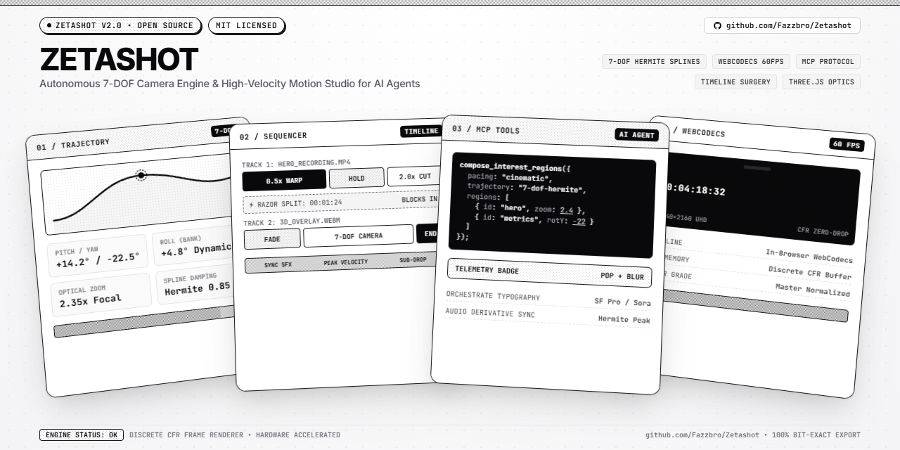

<p align="center">
  
</p>

# Zetashot 🎥✨

[](https://zetashot.vercel.app)
[](https://paypal.me/zetabyteIN)
[](https://opensource.org/licenses/MIT)
[](https://www.typescriptlang.org/)
[](https://react.dev/)

>
> **"Autonomous 7-DOF Camera Engine & High-Velocity SaaS Motion Studio for AI Agents & Creators."**

**Zetashot** is a free, open-source, local-first professional 3D camera mockup studio and motion graphics pipeline. Turn screen recordings, product screenshots, and interactive demos into stunning 60 FPS 3D videos, timeline-sequenced product teasers, and high-resolution captures.

**100% Free • Local-First • Hardware-Accelerated WebGL • In-Browser WebCodecs • Model Context Protocol (MCP) • No Watermarks**

---

## ✨ Features

- **🎥 60 FPS Deterministic 3D Video Export**:
  - Direct frame-sequence rendering into FFmpeg WebAssembly for glitch-free, silky smooth 60 FPS MP4 and WebM video exports.
  - Boundary-clamped Cubic Hermite trajectory interpolation with continuous velocity and zero sudden camera kicks.

- **🪄 Intelligent Multi-Region Choreography Engine**:
  - Draw multiple interest points on any video/screenshot to automatically calculate dynamic 3D camera keyframes.
  - Golden-ratio framing, soft-knee damping, and intelligent 3D parallax angle calculations (pitch, yaw, tilt).

- **📐 Dynamic Multi-Ratio Canvas Framing**:
  - `16:9` (1920×1080 — YouTube / Desktop)
  - `9:16` (1080×1920 — Shorts / TikTok / Reels)
  - `1:1` (1080×1080 — Instagram / Square)
  - `4:3` (1440×1080)
  - `21:9` (2520×1080 — Ultra-wide)

- **✨ Real-Time 3D Specular Light & Fresnel Shaders**:
  - Dynamic WebGL fragment shader calculating realistic glass light sweeps and peripheral fresnel reflections reacting to camera angles in real time.

- **📸 Instant High-Res Photo Mockup Capture**:
  - Hardware-accelerated 2D/3D compositor with drop shadows, lens blur, and custom backdrops.
  - Instant PNG export and direct clipboard copy.

- **⏱️ Professional Keyframe Timeline**:
  - Multi-track camera keyframe inspector with Bézier curve editing, spring physics, and group capsule selection.

---

## 🚀 Getting Started

### Prerequisites
- Node.js 18+ and npm

### Installation

```bash
# Clone repository
git clone https://github.com/Fazzbro/Zetashot.git
cd Zetashot

# Install dependencies
npm install

# Start local dev server
npm run dev
```

Open [http://localhost:5173](http://localhost:5173) in your browser.

---

## 🧪 Testing & Verification

```bash
# Run unit & integration tests
npm run test

# Build production bundle
npm run build
```

---

## 📄 License

MIT © [Zetashot](LICENSE)
